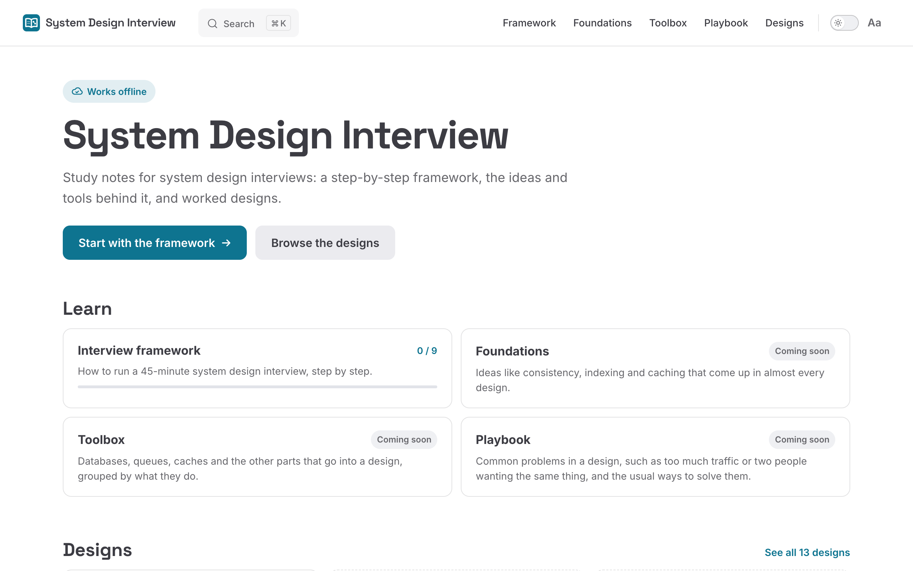

# System Design Interview

Study notes for system design interviews: a step-by-step framework, the ideas and tools behind it, and worked designs. Read them as an ebook:

### [Open the ebook →](https://meghsohor.github.io/system-designs/)

<a href="https://meghsohor.github.io/system-designs/">
  <picture>
    <source media="(prefers-color-scheme: dark)" srcset=".github/assets/site-home-dark.png">
    
  </picture>
</a>

## Reading the ebook

- Works offline after your first visit, and installs as an app on your phone or computer.
- Remembers where you stopped and what you've read, in your browser. No account needed.
- Ends each design with a quiz to check what you remember.
- Reads pages aloud, with text size and dark mode settings.
- Opens any diagram full size.

## What's inside

1. [Interview framework](https://meghsohor.github.io/system-designs/learn/framework/): the 8 steps of a 45-minute interview. Start here.
2. [Foundations](https://meghsohor.github.io/system-designs/learn/foundations/): the ideas each framework step leans on.
3. [Toolbox](https://meghsohor.github.io/system-designs/learn/toolbox/): building blocks grouped by the job they do.
4. [Playbook](https://meghsohor.github.io/system-designs/learn/playbook/): problems interviewers push on, and the moves that solve them.
5. [Designs](https://meghsohor.github.io/system-designs/designs/): worked designs, each ending with a quiz.

Pages still being written show as "Coming soon".

## Running it locally

`npm run dev` starts the site at http://localhost:5173/system-designs/. [AGENTS.md](AGENTS.md) has the other commands and how to add a page.
