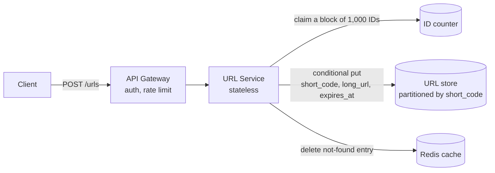
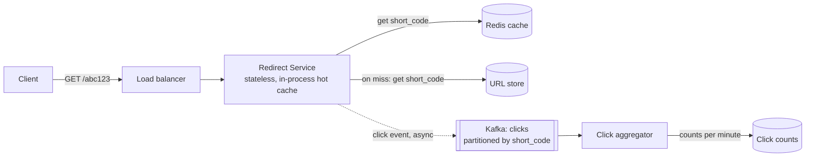
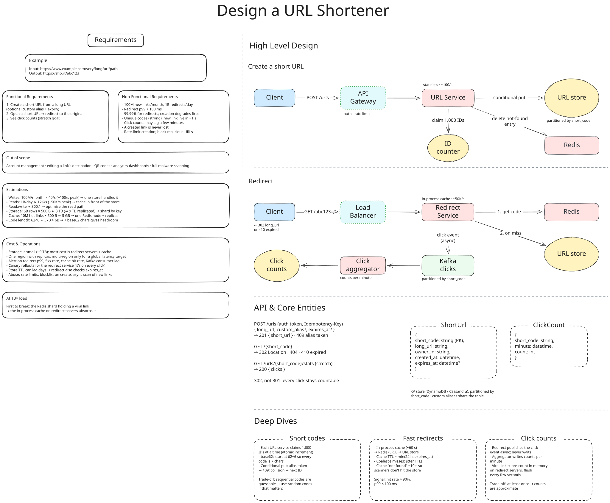

# Designing a URL Shortener

A service like Bitly or TinyURL: users turn long URLs into short links, and
anyone who opens a short link is redirected to the original.

This write-up follows the [interview framework](../../learn/framework/index.md), one section per step.

## 1. Understand the problem

> "We're building a key-value lookup service. Users create short codes for
> long URLs, and anyone with the code gets redirected. It's very read-heavy,
> and redirects must be fast because they sit in front of every click. Short
> codes must be unique, so creating them needs strong consistency."

- **Shape:** read-heavy (hundreds of redirects per link created), request/response.
- **Category:** key-value lookup. Expect deep dives on code generation,
  caching and hot keys.

## 2. Requirements

### Functional

1. Users can create a short URL from a long URL, optionally with a custom alias and an expiry date.
2. Users can open a short URL and be redirected to the original.
3. Users can see how many clicks a link got. *(stretch goal)*

### Non-functional

| Quality | Target |
|---|---|
| Scale | 100M new links per month, 1B redirects per day |
| Latency | Redirect p99 < 100 ms |
| Availability | 99.99% for redirects; link creation can degrade first |
| Consistency | Short codes are unique (strong). A new link may take ~1 s to work everywhere. Click counts may lag a few minutes. |
| Durability | A created link is never lost |
| Abuse | Rate-limit creation per user; reject known-malicious URLs |

### Out of scope

Account management, editing a link's destination, QR codes, analytics
dashboards, and full malware scanning beyond a blocklist check.

## 3. Estimation

| Estimate | Math | So… |
|---|---|---|
| Writes | 100M/month ≈ 3.3M/day ≈ **40/s**, ~100/s at peak | The write path is easy |
| Reads | 1B/day ≈ **12K/s**, ~50K/s at peak | Redirects need a cache in front of the store |
| Read:write ratio | 12K : 40 | ~300:1, so optimise the read path |
| Storage | 100M × 12 × 5 years = 6B rows × ~500 B ≈ **3 TB** (≈ 9 TB with 3 replicas) | Use a store that shards by key |
| Cache | Say 10M hot links × 500 B ≈ **5 GB** | Fits in one Redis node; add replicas for read throughput |
| Code length | 62⁶ ≈ 57B > 6B | 6 base62 characters are enough; 7 gives headroom |

## 4. Core entities

| Entity | Key fields | Notes |
|---|---|---|
| ShortUrl | `short_code` (partition key), `long_url`, `owner_id`, `created_at`, `expires_at` | Read on every redirect; custom aliases live here too |
| User | `id` | Only needed because links have owners |
| ClickEvent | `short_code`, `timestamp`, `country` | Append-only; goes to the analytics stream, not the URL store |
| ClickCount | `short_code`, `minute`, `count` | Pre-aggregated for the stats endpoint |

**Store:** a key-value store partitioned by `short_code` (DynamoDB or
Cassandra). There is one main access pattern (get by code), about 3 TB of
data, and it needs conditional writes for uniqueness. Postgres sharded by
`short_code` would also work. "List my links" needs a secondary index on
`owner_id`.

Custom aliases are stored as ordinary `short_code` values in the same table, so
there's one namespace and one uniqueness check.

## 5. API design

```http
POST /urls
Authorization: Bearer <token>
Idempotency-Key: <uuid>

{ "long_url": "https://example.com/very/long", "custom_alias": "optional", "expires_at": "optional" }

→ 201 Created   { "short_url": "https://sho.rt/abc123", "expires_at": null }
→ 409 Conflict  alias already taken
→ 400 Bad Request  invalid or blocked URL
```

```http
GET /{short_code}

→ 302 Found   Location: <long_url>
→ 404 Not Found
→ 410 Gone   link expired
```

```http
GET /urls/{short_code}/stats        (stretch goal)
Authorization: Bearer <token>

→ 200 OK   { "clicks": 1234 }
```

- The owner comes from the auth token, never the body.
- **302, not 301.** A 301 lets browsers cache the redirect, which cuts
  traffic but hides repeat clicks from us. Click counts are a requirement, so
  we take the extra traffic.

## 6. High-level design

The two flows have very different load (~100/s vs ~50K/s), so they run as
two services that scale on their own.

### Create a short URL

1. The gateway checks the token and the per-user rate limit.
2. The URL service validates the URL and checks it against a blocklist.
3. It takes the next ID from its local block of IDs (see deep dive 1) and
   encodes it in base62. With a custom alias, it uses the alias instead.
4. It writes the row with a **conditional put** (only if `short_code` doesn't
   exist). If the alias is taken, it returns 409. If a generated code
   collides with an old alias, it takes the next ID.
5. It deletes any "not found" cache entry for that code, then returns the short URL.



### Redirect

1. The redirect service checks its small in-process cache, then Redis.
2. On a miss it reads the URL store and fills Redis (cache-aside).
3. It checks `expires_at`: 410 if expired, otherwise 302 to `long_url`.
4. It publishes a click event to Kafka without waiting for the result, so
   analytics never slows a redirect down.



## 7. Deep dives

### Deep dive 1: generating short codes

| Option | How | Pros | Cons |
|---|---|---|---|
| Hash the long URL | MD5/SHA-256 → base62, keep 7 characters | No coordination | Collisions need checks; the same URL from two users gets the same code |
| Single global counter | One counter → base62 | Unique, short | One bottleneck and single point of failure |
| **Counter with ID blocks** | Each URL service instance claims 1,000 IDs at a time with an atomic increment, then hands them out locally | Unique, short, one counter call every ~10 s at peak | Sequential codes are guessable; a crashed instance wastes its block |
| Random code + conditional put | Pick 7 random base62 characters, retry if taken | No coordination, not guessable | Needs a conditional write; retries grow as the keyspace fills |

**Choice:** counter with ID blocks. The counter is one row in the URL store,
updated atomically. Start the counter at 62⁶ so every code is exactly 7
characters. A wasted block costs nothing in a 3.5-trillion keyspace.

**Trade-off:** sequential codes let someone list other people's links by
counting upwards. If that matters, switch to random codes with a conditional
put. At 6B links the keyspace is only ~0.2% full, so retries are rare, and at
~100 writes/s the cost of a conditional write doesn't matter.

### Deep dive 2: fast redirects and viral links

- **Cache-aside in Redis** with an LRU policy. The cache TTL is the smaller of a
  default (e.g. 24 h) and the time until `expires_at`, so expired links don't
  keep redirecting.
- **Hot keys:** one viral link can send most of the traffic to one Redis
  shard. The redirect service keeps a small in-process cache with a short TTL
  (~60 s), which absorbs repeat hits before they reach Redis.
- **Stampede:** when a hot entry expires, many requests miss at once. Only one
  request per code goes to the store; the others wait for its result (request
  coalescing). Add jitter to TTLs.
- **Not-found codes:** scanners request random codes. Cache "not found" for
  ~10 s so they don't hammer the store. The create flow deletes that entry so
  a new alias works straight away.
- **Signal:** cache hit rate above 90%, and redirect p99 under 100 ms.

**Trade-off:** the in-process cache means an expired link can still redirect
for up to 60 seconds. That's acceptable for this product.

### Deep dive 3: counting clicks without slowing redirects

- Redirects publish click events to Kafka without waiting, partitioned by
  `short_code`.
- An aggregator counts clicks per code per minute and writes the totals to the
  click-count table. The stats endpoint sums them.
- **Hot partition:** a viral link puts all its events on one partition. Fix
  this by counting in memory on each redirect server and sending totals every
  few seconds.
- **Signal:** Kafka consumer lag.

**Trade-off:** delivery is at-least-once and batching can lose a few seconds
of counts in a crash, so counts are approximate. That matches the "may lag a
few minutes" requirement.

### Also worth mentioning

- **Expiry cleanup:** DynamoDB's TTL feature deletes expired rows, but
  deletion can lag by days. That's why the redirect also checks `expires_at`.
- **Abuse:** rate limits at the gateway, a blocklist check on create, and an
  async scan of new links that can disable a link later.
- **Cost:** storage is small (~9 TB with replicas). Most of the cost is
  redirect servers and cache, and a high cache hit rate keeps the store small.
  Run in one region with replicas. Go multi-region only if a global latency
  requirement appears.
- **Operations:** alert on redirect p99, 5xx rate, cache hit rate and Kafka
  consumer lag. Roll out the redirect service with canaries, since it's on
  every click.

## 8. Wrap-up

> "It's a read-heavy key-value system. Creating a link takes a 7-character
> base62 code from a block of counter IDs and stores it with a conditional
> write in a store partitioned by code. Redirects are served from an
> in-process cache and Redis in front of that store, which absorbs most of
> the 12K reads per second, and clicks are counted asynchronously through
> Kafka. At 10× load, the first thing to break is the Redis shard holding a
> viral link, which the in-process cache already softens. With more time I'd
> add malicious-URL scanning and a proper analytics pipeline."

**Extensions if asked:** QR codes, editing a link's destination (needs cache
invalidation), and a full analytics pipeline (Kafka → Flink → ClickHouse).

---

### Diagram

The editable source is the [Excalidraw file](https://github.com/meghsohor/system-designs/blob/main/content/designs/url-shortener/url_shortener_system_design.excalidraw).
After editing it, export it as SVG over the image below.


