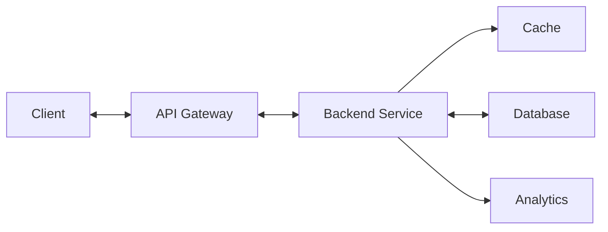
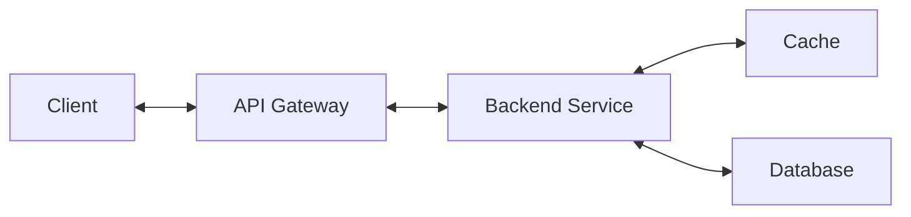
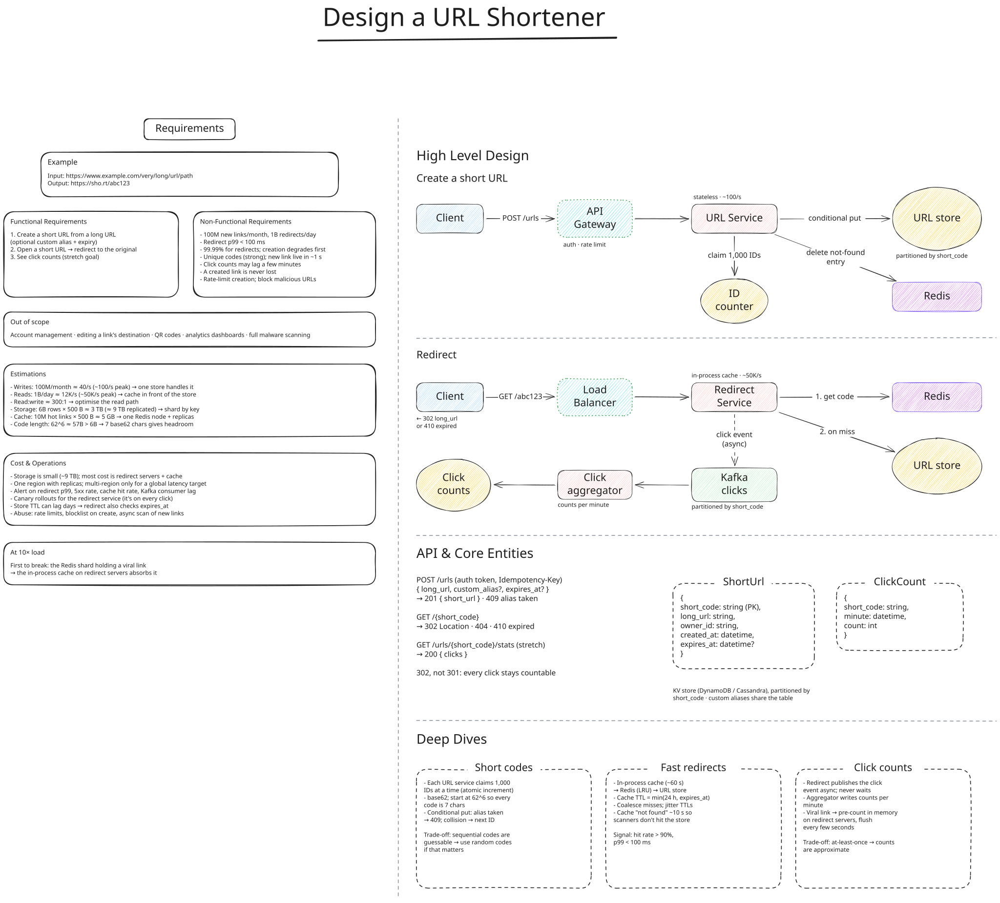

# Designing a URL Shortener

The objective is to design a URL shortener service similar to Bitly or TinyURL. The service should allow users to convert long URLs into shorter, more manageable links that redirect to the original URLs.

## 1. Requirements

### Functional Requirements
- **Shorten URL**: from long URL to shortened URL.
- **Redirect**: from shortened URL to the original URL.
- **Custom Alias**: Users can create custom aliases for their shortened URLs.
- **URL Expiration**: Option to set expiration dates for shortened URLs.
- **Analytics**: Track the number of clicks and other statistics for each shortened URL.

### Non-Functional Requirements
- **Scalability**: The system should handle a large number of requests.
- **Availability**: The service should be highly available with minimal downtime.
- **Performance**: Fast redirection from shortened URL to original URL.
- **Security**: Prevent abuse and ensure data integrity.

### Scale assumptions
- 100M new URLs per month.
- 1B redirections per day.
- Peak traffic of 100K requests per second.
- Store ~several billion URLs total.

## 2. High-Level Architecture

### Generate Short URL
1. **Client**: Sends a request to shorten a URL.
2. **API Gateway**: forwards the request to the appropriate service.
3. **Backend Service**: Validates the URL, generates a unique short code, and stores the mapping in the database and cache.
4. **Database**: NoSQL/SQL database to store URL mappings.
5. **Cache**: In-memory cache (e.g., Redis) for fast lookups of frequently accessed URLs.
6. **Analytics**: Kafka + consumers (optional)



### Redirect Short URL
1. **Client**: Requests the shortened URL.
2. **API Gateway**: forwards the request to the appropriate service.
3. **Backend Service**: Looks up the short code in the cache; if not found, queries the database.
4. **Database/Cache**: Returns the original URL.
5. **Client**: Redirects to the original URL.



## 3. URL Key Generation Strategies

### Option A: Hashing (MD5/SHA-256) + Base62
- Pros: Deterministic, easy
- Cons: Collisions must be handled

### Option B: Auto-increment ID → Base62
- Example: ID=123456 → “W7e8”
- Pros: No collisions, tiny keys, simple
- Cons: Requires coordination for ID generation

### Option C: Distributed ID generator
- Pros: Guaranteed unique, distributed
- Cons: More complex

## 4. Database Schema

For billions of entries, NoSQL (Cassandra / DynamoDB) is the common answer, but SQL also works if sharded.

#### Schema:

```json
ShortURL: {
   id: string (key),
   long_url: string,
   created_at: datetime,
   expiration: datetime (optional),
   user_id: string (optional)
}
```

## 5. Read Path (Redirect)
Redirects are extremely frequent.
This must be blazing fast.

#### Steps:

1. Check cache (Redis).
2. If hit → return redirect.
3. If miss → query DB.
4. Populate cache.

#### Caching details:

- TTL: few days
- Use LRU
- Hot URLs stay in cache automatically

## 6. Write Path (Creating Short URLs)

#### Steps:
1. Request long URL from client.
2. Generate ID.
3. Write to DB.
4. Write to cache.
5. Return short URL.

Use `write-through caching` for freshness.

## 7. Traffic-Specific Scaling

#### Handling 1B redirects/day
- Cache hit rate must be > 90%.
- Global distribution with CDNs (Optional. Can't use CDN if analytics needed).
- Geographically distributed caches.

#### DB
- Append-only workloads → excellent for NoSQL
- Replication for HA

#### Availability
- Load balancer in front of backend services.
- Stateless app servers → easy autoscaling.

## 8. Discussing Trade-offs
Interviewers love hearing:

- Collision avoidance strategy.
- Strong consistency vs eventual consistency.
- Handling hot URLs (cache them with higher priority).
- Rate-limiting to prevent abuse.
- Security concerns (malicious/unsafe URLs).

## 9. Optional Extensions (if interviewer asks)
- QR code generation.
- Custom aliases: `WWW.XYZ/HELLO` → store alias index.
- URL analytics pipeline (Kafka → Flink → Clickhouse).
- Spam/malware detection.



